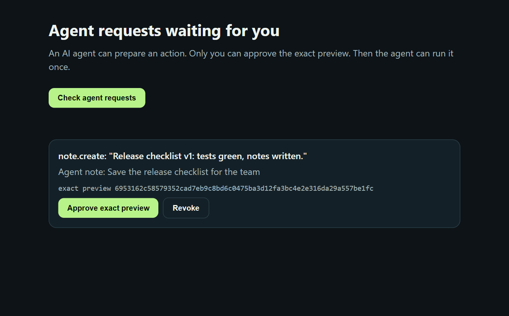

# mcp-human-approval-gate

[](https://github.com/Daniel221287/mcp-human-approval-gate/actions/workflows/test.yml)

**An AI agent prepares an action. Only a human can approve the exact preview. Then the agent runs it once.**

A tiny, dependency-light MCP server, an Agent Skill and a reusable gate you can drop into your own agent tools. MIT licensed.

## Why it matters

- Agents with tools can now change real things: files, messages, orders, payments.
- "Ask before acting" written in a prompt is not a control. The agent must be **technically unable** to approve itself.
- Network calls time out. If an agent blindly retries an uncertain action, you get the email twice or the payment twice.

This gate turns those three points into code:

| Rule | How it is enforced |
|---|---|
| The agent cannot approve | The MCP server has **no approve tool**. Approval exists only on a local human page protected by a per-start token |
| The human approves exactly what will run | Approval is bound to the **SHA-256 of the preview**. Any change means a new hash and a new approval |
| It runs once | The execution slot is **reserved before the effect starts**. A second call, a crash or a timeout is never replayed |
| It really happened | The effect must **read back** what it did. Unverified results are marked `FAILED_NO_RETRY` |
| Nothing waits forever | Requests and approvals **expire** (10 minutes by default). Max 20 pending requests |

## How it works

```
agent ── approval_prepare ──► PREVIEW_READY ──► shown on the human page
                                                   │
                         human: "Approve exact preview" (hash must match)
                                                   ▼
agent ── approval_execute ──► APPROVED_BY_HUMAN ──► effect + readback ──► SUCCEEDED_VERIFIED
agent ── approval_execute again ──► refused: ALREADY_EXECUTED_NO_REPLAY
agent ── approval_status ──► read-only answer: what happened, retry_allowed: false
human: "Revoke" ──► REVOKED_BEFORE_EFFECT (can never run)
```



*A real run: the agent's request waits on the human page. Before approval, `approval_execute` is refused with `EXACT_PREVIEW_APPROVAL_REQUIRED`. After one click on "Approve exact preview" it runs once (`SUCCEEDED_VERIFIED`), and a second call is refused with `ALREADY_EXECUTED_NO_REPLAY`.*

## Quick start

Requires Node.js 22 or newer.

```bash
npm install
npm start
```

The console prints two lines:

```
MCP endpoint: http://127.0.0.1:4800/mcp
Human page:   http://127.0.0.1:4800/?t=<random token for this start>
```

1. Open the **human page** in your browser yourself. Do not give this link to the agent.
2. Connect your MCP client (Streamable HTTP transport) to the **MCP endpoint**.
3. Ask the agent to create a note. It prepares it, you approve the exact preview, it runs it once.

The example effect creates one new text file in `./sandbox` (a server-generated name, never overwriting) and verifies it by reading it back. The agent never chooses a path.

## MCP tools (for the agent)

| Tool | What it does |
|---|---|
| `approval_prepare` | Prepares a `note.create` preview. Nothing runs yet |
| `approval_status` | Read-only: state and result of a request. Never runs anything |
| `approval_execute` | Runs a request once, only if a human approved this exact `preview_sha256` |

## Human endpoints (for the page, token required)

`POST /human/pending`, `/human/approve`, `/human/revoke`, `/human/status`, each with the `X-Human-Token` header. Requests without the right token get `401 HUMAN_TOKEN_REQUIRED`.

## Use the gate in your own code

```js
import { ApprovalGate } from './src/gate.mjs';

const gate = new ApprovalGate({ ttlMs: 10 * 60 * 1000, maxPending: 20 });

// Agent side
const req = gate.prepare({ action: 'email.send', payload: { to: 'team@example.com', subject: 'Release' }, requestedBy: 'agent' });

// Human side (your UI, never an agent tool)
gate.approve({ id: req.id, previewSha256: req.preview_sha256 });

// Agent side: runs once, your effect must read back what it did
await gate.execute({ id: req.id, previewSha256: req.preview_sha256 }, async (preview) => {
  const sent = await sendEmail(preview.payload);       // your code
  return { verified: sent.accepted === true, detail: { messageId: sent.id } };
});
```

## Verified with a real agent (Claude Code)

On 23 October 2026 the gate was tested with **Claude Code CLI** (model Sonnet, subscription login) as the MCP client. The agent had **only** this MCP server and the Agent Skill (copied into `.claude/skills/human-approval-gate/` of its working folder). Bash, Edit, Write and web tools were disabled.

```json
{ "mcpServers": { "gate": { "type": "http", "url": "http://127.0.0.1:4800/mcp" } } }
```

```bash
claude -p "Use the human-approval-gate skill. Save this short note: ..." --model sonnet \
  --mcp-config mcp.json --strict-mcp-config --setting-sources project \
  --allowedTools mcp__gate__approval_prepare mcp__gate__approval_status mcp__gate__approval_execute Skill \
  --disallowedTools Bash Edit Write WebFetch WebSearch
```

What happened in that run (the server ran on port 4810; server state is the ground truth):

1. The agent loaded the skill and called `approval_prepare` → `PREVIEW_READY`.
2. It **stopped by itself** and said: *"This is waiting on your local approval page. Preview hash to match: `1ac57128b556`. Please approve it there, then tell me and I'll execute it once."*
3. The exact preview was approved on the human page.
4. Resumed with *"I approved the exact preview on my approval page. Please continue."*, the agent called `approval_execute` **once** → `SUCCEEDED_VERIFIED` (a 49-byte note, readback verified, exactly one file in the sandbox).

## Agent Skill

[`skills/human-approval-gate/SKILL.md`](skills/human-approval-gate/SKILL.md) tells an agent how to behave around the gate: prepare, tell the human what is waiting, execute once after approval, use `approval_status` instead of retrying. Copy the folder into your agent's skills directory.

## Security model and honest limits

- Listens on `127.0.0.1` only and refuses any other host. Host and Origin headers are validated with the MCP SDK's localhost guards (DNS rebinding protection). The page is served with a strict Content-Security-Policy.
- The human token separates the human channel from the MCP channel. It is **not** a sandbox against a local process that can read your console or browser.
- State is in memory. Restarting the server clears all requests, which is the safe direction: nothing approved survives a restart.
- The included effect is deliberately harmless. Real effects (email, payments) are yours to write, and they must return a real readback.

## Tests

```bash
npm test
```

14 tests: 8 unit tests for the gate and the example effect, and 6 live tests that start the real server on a random local port and talk to it over MCP JSON-RPC and HTTP (no approve tool, token-protected human channel, exact-hash approval, single execution, revoke, Origin and Host guards, loopback-only binding).

## Background

Built during the Amazon **Build, Ship, Shape** hackathon (October 2026) as the open-source, reusable core of the human-approval pattern behind my hackathon entry. Written from scratch for this repository.

**Related project video:** [Watch GnyPcior SafeDesk v4 (Amazon hackathon demo)](https://www.youtube.com/watch?v=izSZTK0me5o) to see this broader human-approval idea in a full agent application. SafeDesk is a separate project; the video is not a walkthrough of this standalone gate.

## License

[MIT](LICENSE)
